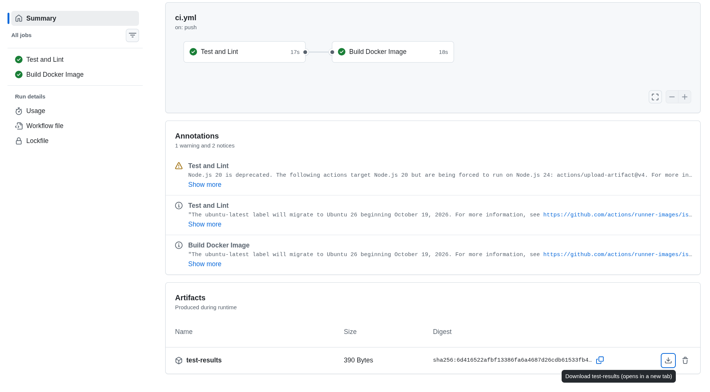
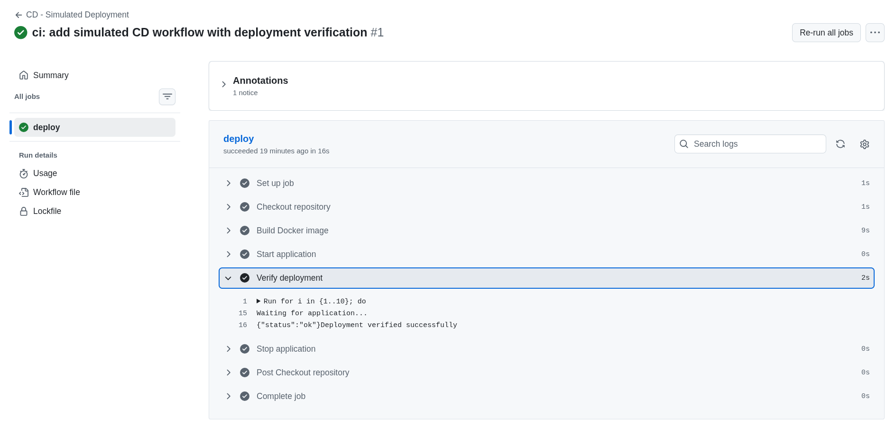
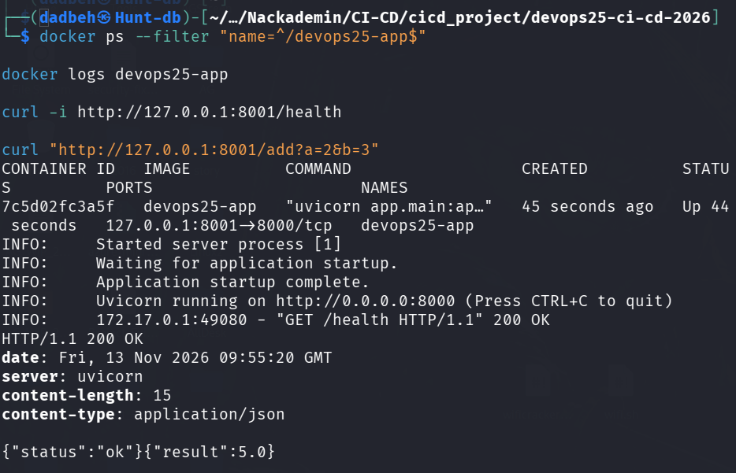

# Dag 5 – Continuous Delivery och verifiering

## Syfte

Under dag 5 har jag arbetat vidare med applikationen från dag 4. Målet var att förstå hur vi kan gå från automatiska tester och Docker-byggen till en simulerad driftsättning, och hur vi kontrollerar att applikationen faktiskt fungerar.

## Artifacts i GitHub Actions

Jag uppdaterade CI-workflowen så att Pytest skapar filen `test-results.xml`.

Jag lade också till `actions/upload-artifact@v4` för att spara rapporten i GitHub Actions. Med `if: always()` försöker jobbet ladda upp rapporten även om testerna misslyckas, så länge rapportfilen har skapats.

Jag uppdaterade också checkout och setup-python till version 6.

Efter pushen lyckades båda CI-jobben. I körningens Summary kunde jag se och ladda ned artifacten `test-results`.

En grön workflow-körning visar att jobbet lyckades. En artifact är däremot en sparad fil från körningen, som vi kan undersöka efteråt.



## Demo 5A – Simulerat CD-workflow

Jag skapade `.github/workflows/cd-simulated.yml` i min egen branch `demo/dag5-cd-MReza`.

Workflowen innehåller fyra viktiga steg:

1. Bygg en Docker-image.
2. Starta applikationen i en container.
3. Verifiera applikationen via `/health`.
4. Stoppa och ta bort containern.

Jag använde `actions/checkout@v6` enligt genomgången.

## Demo 5B – GitHub Actions och loggar

När jag pushade ändringen startade både CI och CD automatiskt.

Båda körningarna lyckades. I CD-loggarna såg jag först att applikationen behövde lite tid för att starta. Därefter svarade `/health` med `{"status":"ok"}` och loggen visade `Deployment verified successfully`.

Även steget för att stoppa containern lyckades.

Det är viktigt att förstå att CI och CD startar oberoende av varandra i den här övningen. CD väntar alltså inte automatiskt på att testerna i CI ska bli godkända.



## Demo 5C – Lokal deployment

Jag skapade två Bash-skript:

- `scripts/deploy_local.sh` bygger imagen och startar containern.
- `scripts/verify.sh` kontrollerar om applikationen svarar via `/health`.

Port 8000 användes redan av en annan Docker-container på min dator. Jag ville inte stoppa den eftersom den hör till ett annat projekt.

Därför lade jag till variabeln `HOST_PORT`, som har 8000 som standardvärde. För den här övningen använde jag 8001.

Jag körde:

```bash
HOST_PORT=8001 bash scripts/deploy_local.sh
HOST_PORT=8001 bash scripts/verify.sh
```

Imagen byggdes, containern startade och verifieringen lyckades.

## Demo 5D – Kontrollera applikationen

Jag kontrollerade containern med `docker ps` och `docker logs`.

Sedan testade jag två endpoints:

- `/health` gav HTTP 200 och `{"status":"ok"}`.
- `/add?a=2&b=3` gav `{"result":5.0}`.

Det visar både att containern kördes och att applikationen kunde svara på förfrågningar.

Efter kontrollen tog jag bort övningscontainern med `docker rm -f devops25-app`. Den andra containern på port 8000 lämnades orörd.



## Reflektion

### 1. Vad är skillnaden mellan att en container körs och att applikationen fungerar?

`docker ps` visar att containern körs, men det betyder inte automatiskt att applikationen fungerar. Därför behöver vi kontrollera tjänsten, till exempel med `/health`.

### 2. Varför använder vi både automatiserade tester och en /health-kontroll?

Automatiserade tester kontrollerar applikationens förväntade beteende. En health check kontrollerar att tjänsten går att nå efter att den har startats.

Båda behövs eftersom en applikation kan klara testerna men ändå få problem när den startas i en container.

### 3. Varför är detta en simulerad driftsättning?

Containern körs på en tillfällig GitHub-runner och tas bort när jobbet avslutas. Vi har inte publicerat applikationen på en riktig produktionsserver.

### 4. Vad kan hända när CI och CD startar oberoende av varandra?

CD kan starta även om CI inte har hunnit bli färdig eller om testerna misslyckas.

I ett riktigt projekt skulle jag vilja att deployment väntar på godkända tester och andra kontroller innan en release tillåts.

## Min CI/CD-kedja

Samma push startar två oberoende workflows:

```text
Push: demo/dag5-cd-MReza
|
+-- CI Pipeline
|   +-- Pytest -> test-results.xml
|   +-- Upload Artifact: test-results
|   +-- Ruff
|   +-- Docker Build (efter godkända tester och lint)
|
+-- CD - Simulated Deployment
    +-- Build Docker image
    +-- Start container
    +-- Verify /health
    +-- Stop container (cleanup)
```

CD väntar inte pa ett godkant CI-resultat i denna ovning.

## Risker och förbättringar

Verifieringen kontrollerar `/health`, men det är ingen garanti för att alla funktioner fungerar.

Om `/health` inte svarar inom de tio försöken avslutas verifieringen med felstatus. Cleanup-steget använder `if: always()` för att försöka ta bort containern även vid fel.

Jag har inte genomfört ett separat avsiktligt feltest av CD-verifieringen i den här övningen.

För en produktionsmiljö skulle jag också vilja ha versionshanterade images, skyddade miljöer, tydligare beroenden mellan CI och CD samt en plan för rollback.

## Körningar och bevis

- [CI med artifact – körning 16](https://github.com/MohammadRezaHeydari-se/devops25-ci-cd-2026/actions/runs/43293215273)
- [CI efter CD-ändringen – körning 17](https://github.com/MohammadRezaHeydari-se/devops25-ci-cd-2026/actions/runs/43298066062)
- [Simulerad CD – körning 1](https://github.com/MohammadRezaHeydari-se/devops25-ci-cd-2026/actions/runs/43298066190)

## Slutsats

Jag har lärt mig att en lyckad build inte räcker för att säga att applikationen fungerar. Vi behöver också starta tjänsten, verifiera den och kontrollera loggarna.

Jag har även förstått varför sparade testresultat är användbara och varför en riktig leveranskedja behöver tydligare kontroller innan deployment.
